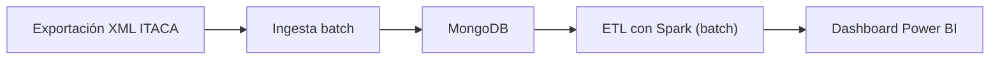

# Proyecto 1 · Analítica académica ITACA (origen XML)

> Proyecto del módulo Big Data aplicado. Dashboard de análisis académico en Power BI a partir de exportaciones XML de ITACA, con una arquitectura batch.

## Descripción y objetivo

Ingestar las exportaciones XML de la plataforma ITACA de la Conselleria de Educación, almacenarlas en MongoDB y transformarlas con Spark para alimentar un dashboard académico en Power BI.

El objetivo es disponer de un flujo reproducible desde los datos originales hasta los indicadores académicos, preservando la privacidad de la información del alumnado.

**Estado actual:** repositorio inicializado y servicio MongoDB definido con Docker Compose. Los scripts de ingesta, las transformaciones y el dashboard están pendientes de implementación.

## Arquitectura



*Arquitectura prevista. Actualmente solo está configurado el servicio MongoDB; el diagrama se actualizará al completar cada bloque.*

## Fuentes de datos

| Fuente | URL / origen | Formato | Frecuencia de actualización | Licencia / condiciones de uso | Última ingesta |
| --- | --- | --- | --- | --- | --- |
| ITACA | Fichero exportado desde la plataforma educativa | XML | Manual, según la exportación facilitada para la práctica | Datos educativos de acceso restringido; utilizar únicamente con autorización y sin publicar información personal | Pendiente |

Los XML originales y cualquier dato identificativo del alumnado no deben publicarse en el repositorio. La anonimización y la selección de campos se concretarán antes de la ingesta.

## Estructura del repositorio

| Carpeta / archivo | Contenido y estado |
| --- | --- |
| `ingesta/` | Carpeta local reservada para los scripts de lectura de XML; pendiente de implementación |
| `etl/` | Carpeta local reservada para las transformaciones con Spark y el modelo de datos |
| `dashboard/` | Carpeta local reservada para el informe de Power BI |
| `data/raw/` | Datos originales; actualmente contiene un `.gitkeep` versionado |
| `data/staged/` | Datos intermedios; actualmente contiene un `.gitkeep` versionado |
| `data/curated/` | Datos preparados para análisis; actualmente contiene un `.gitkeep` versionado |
| `docker-compose.yml` | Servicio MongoDB 7, volumen persistente y red de desarrollo |
| `.env.example` | Plantilla de configuración, actualmente vacía |
| `.gitignore` | Exclusión actual del archivo local `.env` |
| `README.md` | Descripción, despliegue y bitácora del proyecto |

**Nota:** Git no registra carpetas vacías. Por ello, `ingesta/`, `etl/` y `dashboard/` pueden existir localmente sin aparecer en un clon del repositorio hasta que incorporen contenido o un `.gitkeep`.

## Cómo desplegar el entorno

### Requisitos

- Docker Engine o Docker Desktop en ejecución y Docker Compose v2.
- Puerto local `27017` disponible.
- Ejecutar los comandos desde la raíz de este proyecto.

### Arrancar MongoDB

```bash
docker compose up -d
docker compose ps
```

El contenedor se llama `bigdata-mongo` y utiliza la imagen `mongo:7`. MongoDB queda accesible en `mongodb://localhost:27017`, con persistencia en el volumen `mongo-data`.

Para comprobar que responde:

```bash
docker compose exec mongo mongosh --quiet --eval 'db.adminCommand({ ping: 1 })'
```

El resultado esperado incluye `ok: 1`. Para consultar los registros o detener el entorno sin eliminar el volumen:

```bash
docker compose logs mongo
docker compose down
```

**Seguridad:** esta configuración no define autenticación y publica el puerto de MongoDB. Es un entorno de prácticas local; no debe exponerse a redes no confiables ni usarse en producción tal como está.

## Bitácora de prácticas

### Bloque 0 · Entorno

- **Objetivo:** preparar el repositorio y un MongoDB local con Docker.
- **Pasos realizados:** creación del README, `.gitignore`, `.env.example`, directorios de datos con `.gitkeep` y `docker-compose.yml` con MongoDB 7, red y volumen persistente.
- **Problemas encontrados y solución:** las carpetas vacías no aparecen en Git; los tres directorios de datos ya incluyen `.gitkeep`. Las carpetas de código pendientes siguen sin contenido versionado.
- **Resultado:** configuración de MongoDB disponible. La comprobación del entorno se realiza con `docker compose ps` y el comando de ping anterior; no se incluye todavía una captura de ejecución en este README.

### Bloque 1 · Ingesta batch

- **Objetivo:** leer las exportaciones XML y cargar los documentos necesarios en MongoDB.
- **Pasos realizados:** pendiente de implementación.
- **Problemas encontrados y solución:** pendientes de registrar durante la ingesta.
- **Resultado:** pendiente; se documentarán el fichero de origen, la fecha de carga y el número de documentos insertados.

### Siguientes bloques · ETL y visualización

- **Objetivo:** transformar los datos con Spark y construir el dashboard en Power BI.
- **Pasos realizados:** pendientes de implementación.
- **Problemas encontrados y solución:** pendientes de registrar.
- **Resultado:** pendiente de definir y validar el modelo analítico y sus indicadores.

## Decisiones técnicas

| Decisión | Alternativa considerada | Motivo |
| --- | --- | --- |
| MongoDB 7 en Docker | Instalación nativa de MongoDB | Facilita reproducir el entorno y aislar las dependencias |
| Transformar el XML a documentos para MongoDB | Cargar directamente el XML en una base relacional | Permite representar estructuras jerárquicas mediante documentos BSON; la conversión se implementará en la ingesta |
| Ingesta batch | Captura en streaming | El origen disponible consiste en exportaciones XML puntuales |
| Spark y Power BI como destino previsto | Un único script con informes estáticos | Separa la transformación de datos de la exploración visual |

## Incidencias resueltas

| Incidencia | Solución / estado |
| --- | --- |
| Faltaba la sección de estructura del repositorio señalada en la revisión | Se documentan los archivos y carpetas, distinguiendo los elementos versionados de las carpetas locales vacías |
| Los directorios de datos vacíos no aparecían en Git | Ya existen archivos `.gitkeep` en `data/raw/`, `data/staged/` y `data/curated/` |

**Pendiente de la revisión:** ampliar `.gitignore` para cubrir datos, credenciales, entornos Python y notebooks, y versionar las carpetas de código cuando tengan contenido. La actualización de este README no modifica esos archivos ni incorpora datos al repositorio.
